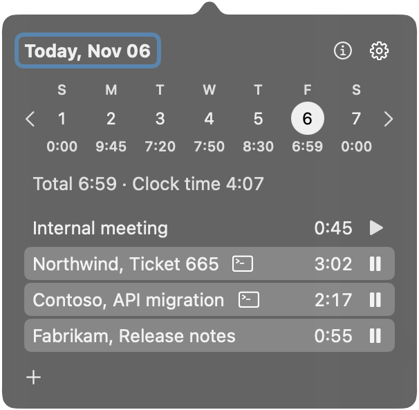

# Chronobar

A menu bar time tracker for macOS that times several pieces of work at once, and that your AI agents
can start, stop and correct for you.

<p>
  
</p>

<p>
  
</p>

## Why

If you run several agent sessions in parallel, one for each client, you spend the hour moving between
them: reading output, steering, stepping in. That is one hour of your time and an hour of work on each
client's job. A tracker with one timer can't record it.

Chronobar gives each piece of work its own timer, and they run side by side. Your agent starts one when
it picks up a ticket and stops it when the work is done, through MCP or a plain command line. You can
do the same from the menu bar. Everything stays on your Mac, in plain files.

## Features

- **Timers side by side.** Each timer is just a Label you type, such as "Northwind, Ticket 665" or
  "Internal meeting". There are no projects or clients to set up first. Start as many as you like; each
  Label has one timer, so the same work is never counted twice.
- **Driven by your agents.** Any MCP client can start, stop and read timers. Scripts, git hooks and
  agent hooks can use the `chronobar` command, which has the same operations.
- **"Stop the timer" means the session's own timer.** Each agent session remembers the timers it
  started, so it stops the right one without being told the name. If it can't tell, it lists the
  running timers and asks.
- **Corrections after the fact.** Stop a timer back when the work finished, move a start, add a line
  item for work you forgot to time, or set a Day's total. Future times and overlapping time are
  refused.
- **Total and Clock time.** The Panel shows what you'll bill and how long you actually worked:
  `Total 6:59 · Clock time 4:07`. Rows always add up to the Total, down to the minute.
- **Safe when you walk away.** Timers you started in the app ask whether to drop the time when you come
  back from sleep, a locked screen or a break. Agents' timers keep running, because their work goes on.
  Any timer still running after 4 hours raises a notification with a Stop button; Chronobar never cuts
  time on its own.
- **Plain-text data.** One JSON file per Day and two text files of Labels. Edit them by hand and
  Chronobar picks up the change.
- **Keyboard and VoiceOver.** Every control works from the keyboard, the Panel's shortcuts follow your
  keyboard layout, and VoiceOver reads the Pill, every row and the totals.

[Using the app](docs/app.md) covers the Pill, the Panel, its keys and Settings in detail.

## Install

You need macOS 14 Sonoma or later and the Command Line Tools (`xcode-select --install`). Xcode is not
required. Homebrew builds Chronobar on your Mac:

```sh
brew install nhall/tap/chronobar
```

This installs the app and the `chronobar` command. To open the app from Spotlight, Launchpad and Finder,
link it into `~/Applications` once (the link survives upgrades), then open it:

```sh
ln -sfn "$(brew --prefix)/opt/chronobar/Chronobar.app" ~/Applications/Chronobar.app
open ~/Applications/Chronobar.app
```

The app is compiled and signed on your own Mac, so it opens without a Gatekeeper warning. The
`chronobar` command launches it in the background whenever it isn't running.

Update with `brew upgrade chronobar`. To remove it, quit Chronobar, then run `brew uninstall chronobar`
and `rm ~/Applications/Chronobar.app`. Your data stays in `~/Library/Application Support/Chronobar`
until you delete that folder.

### First run

Click the Pill, the `0 0:00` in the menu bar. In the Panel, click ＋, type a Label and press Return: its
timer starts and the Pill counts it. Each row's ⏸ pauses that timer, and ▶ starts it again. Turn on
Start at login in Settings (⚙) if you want Chronobar there every day.

## Connect your agent

`chronobar mcp` is an MCP server on standard input and output. Register it once and it's
available in every project.

**Claude Code**

```sh
claude mcp add --scope user chronobar -- chronobar mcp
```

**Codex**

```sh
codex mcp add chronobar -- chronobar mcp
```

**Gemini CLI**

```sh
gemini mcp add --scope user chronobar chronobar mcp
```

**Claude Desktop and Cursor** read a JSON file: in Claude Desktop, Settings › Developer › Edit Config;
for Cursor, `~/.cursor/mcp.json`. Apps opened from the Dock don't see your shell's `PATH`, so give the
full path (`/usr/local/bin/chronobar` on an Intel Mac), then quit and reopen the app:

```json
{
  "mcpServers": {
    "chronobar": {
      "command": "/opt/homebrew/bin/chronobar",
      "args": ["mcp"]
    }
  }
}
```

Then talk to your agent:

- "Start a timer for Northwind, Ticket 665."
- "Stop the timer back when you finished."
- "Add a line item for the hour that took us this morning."
- "How much time went to Northwind this week?"

[Agents](docs/agents.md) lists the tools, the config-file forms of each setup, and how sessions decide
which timer to stop.

## The command line

The same operations, for scripts and hooks:

```sh
chronobar start "Northwind, Ticket 665"
chronobar status
chronobar stop --at 14:40          # the only running timer, back when the work finished
chronobar day                      # today's Labels, Total and Clock time
chronobar --json week              # this week, as JSON
```

Times are `HH:MM` today or ISO 8601 with an offset. `--json` prints structured results with totals in
whole seconds, and the exit status says whether the request was carried out, refused, or couldn't
reach the app. [The command line](docs/command-line.md) has every command, rule and error.

## Your data

Chronobar has no accounts, no sync and no network access. Your time lives in
`~/Library/Application Support/Chronobar`:

```
days/2026-11-06.json   one file per Day, one entry per line
projects.txt           pinned Labels
archived.txt           archived Labels
```

A Day file is readable JSON:

```json
{ "project": "Northwind, Ticket 665", "start": "2026-11-06T13:40:00-05:00", "end": null, "source": "agent" }
```

The app is the only writer, and it re-reads a file before every change, so a hand edit is never
overwritten. A file that stops being valid JSON is left alone until you fix it.
[Data format](docs/data-format.md) describes every field and how totals are counted.

## Build from source

```sh
git clone https://github.com/nhall/chronobar.git
cd chronobar
scripts/bundle-app.sh            # builds build/Chronobar.app and build/bin/chronobar
open build/Chronobar.app
```

[Development](docs/development.md) covers the tests and a development copy that runs beside your
everyday one. Before a release, work through the [manual test checklist](docs/manual-checklist.md) and
[Releasing](docs/releasing.md).

## License

MIT. See [LICENSE](LICENSE).
